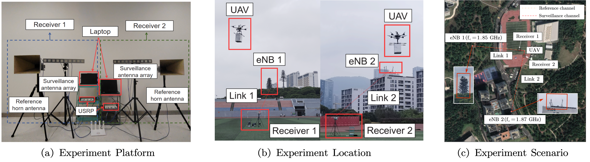
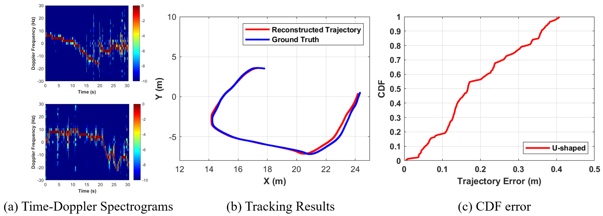
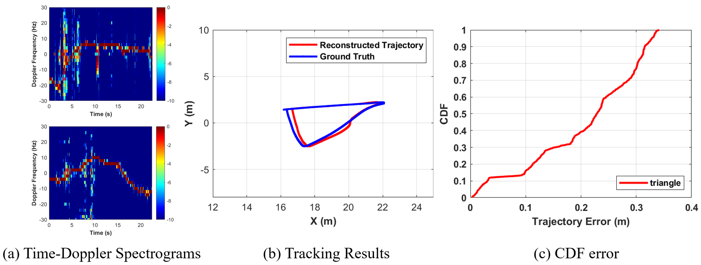

# An Experimental Study on Fine-Grained Multistatic Sensing of UAV Trajectory via Cellular Downlink Signal

Thank you for your interest in our work! This repository **maintains all the codes of this work**.

## Introduction
In this work, we proposed a **Doppler-only multistatic passive unmanned aerial vehicles (UAVs) tracking system utilizing downlink long-term evolution (LTE) signals**. The performance of trajectory tracking is demonstrated by experiments on a low-altitude two-dimensional plain. Our experiments demonstrated that **the tracking errors are below 50 cm for 90% of the trajectory, when the distance between the UAV and sensing receivers is below 30 m**. 

**Note: Detailed documentation of each directory, source codes, and paper information will be coming soon (maybe after paper acceptance).**








## Dataset

### Overview

The dataset is designed to support research in **passive radar, UAV tracking, and integrated sensing and communications (ISAC)** by providing raw and processed data from real-world experiments.

The dataset is available at [Here](https://lasso525.quickconnect.cn/d/s/12gRTWCXynuW6Srov7kWhZRYhru1LXts/9QsN_gaKp7aB1_PTxVsC76w9JUuBhOLb-ebfgm6_tJgw).

### Description

The dataset contains the following components:

- **Processed raw baseband signal datas (.mat)**: **Processed raw baseband signals collected by software-defined radios (SDRs) from LTE downlink transmissions at the two receivers** (Added some random phase noise to prevent the original LTE communication datas from being publicly disclosed). This directory contains **four .mat files**, representing the processed raw baseband signals of four UAV flight trajectories at the two receivers: **U-shaped, triangle, V-shaped and circle**.
- **GPS ground truth logs (.txt)**: **The GPS logs of the ground truth correspond to the above four flight trajectories**, recorded by the onboard RTK module with centimeter-level accuracy.

### Experiments Setup

- **Transmitter**: **two** Commercial LTE eNB operating at 1840-1860 MHz and 1860-1880 MHz respectively.
- **Receiver**: Passive sensing system with two receiver.
- **Target**: The target UAV is flying four different trajectories on a low-altitude two-dimensional plain while reflecting LTE signals, when the distance between the UAV and sensing receivers is below 30 m.
- **Baseline Distance**: The distances between two LTE eNBs and the corresponding receivers are approximately
  200 m and 220 m, respectively. 
- **Sampling Rate**: 5 MHz.

### File Structure

The dataset is organized as follows:

```text
Dataset
|-- Processed_raw_data # Processed raw baseband signals of four flight trajectories at the two receivers
    |-- U-shaped.mat     
    |-- triangle.mat    
    |-- V-shaped.mat    
    |-- circle.mat    
|-- GPS_log   # Ground truth GPS logs of the corresponding four flight trajectories
    |-- U-shaped.txt     
    |-- triangle.txt    
    |-- V-shaped.txt    
    |-- circle.txt  
```

## Running
### 1. Clone this Repository

```bash
git clone https://github.com/Jcq242818/Passive_UAV_Tracking.git --recursive
```

### 2. **Download the Dataset**

- Due to its large size, the dataset cannot be directly uploaded to GitHub. So please download it from the following link: 🔗[Download Link](https://lasso525.quickconnect.cn/d/s/12gRTWCXynuW6Srov7kWhZRYhru1LXts/9QsN_gaKp7aB1_PTxVsC76w9JUuBhOLb-ebfgm6_tJgw)
- Then, please add the Dataset folder to this repository.

### 3. Run the Corresponding MATLAB Script

Open MATLAB and run the **[main.m](./main.m)** scripts to read the raw **.mat** data in Dataset folder and then perform the modules as **interference cancellation, CAF, threshold-based filtering, interpolation and weighted averaging algorithm, Kalman Filter and UAV Trajectory Tracking algorithm** in sequence. Each module mentioned above is encapsulated as a function in the [./Function]( ./Function) directory.

## Citation

If you find the repository is helpful to your research projects, please cite as follows:

```bibtex
@inproceedings{zhao2023nerf2,
    author = {Chenqing Ji, Jiahong Liu, Qionghui Liu, Yifei Sun, Chao Yu and Rui Wang},
    title = {An Experimental Study on Fine-Grained Multistatic Sensing of UAV Trajectory via Cellular Downlink Signal},
    booktitle = {},
    pages = {1--5},
    year = {2025}
}
```

## Contact

For any questions, please contact:

- Chenqing Ji: 12332152@mail.sustech.edu.cn

## Acknowledgement

This work is under supervision of Prof. Rui Wang.